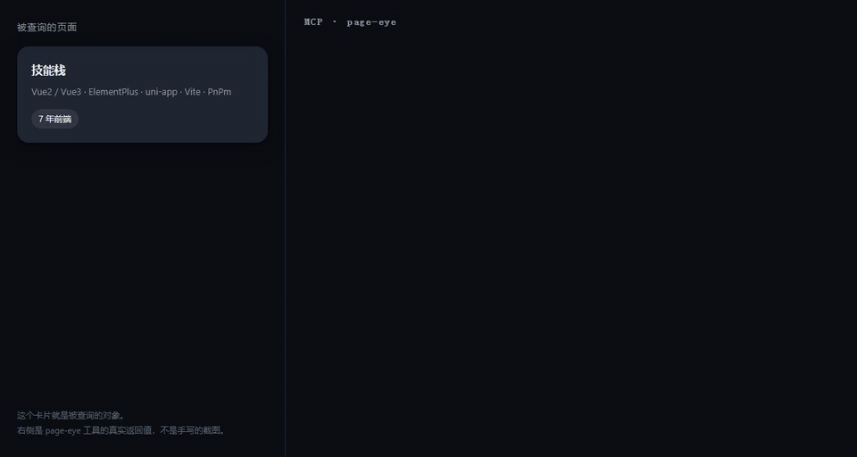

# page-eye

Give your AI coding agent a pair of eyes on the page.

AI assistants read source code. They cannot read what the browser actually paints — the background may be a `var(--x)` resolved three layers deep, spacing may come from a component library default, a shadow may be a five-part `shadow-sm`, an icon may be one invisible private-use character inside a `::before`. And network responses, console errors, what happened after a click — none of that exists in the source at all.

Two complementary tools in this repo, both built around one idea: **stop transcribing, let the agent talk to the live page.**



> That is not a hand-written mock. Every line on the right is a real return value from the `element_style` tool. The last step changes the card's `--card-bg` and asks again — the new value is whatever the browser paints at that moment.

## Quick start (3 steps)

**1. Start Chrome with a debugging port**

```powershell
& "$env:LOCALAPPDATA\Google\Chrome\Application\chrome.exe" `
  --remote-debugging-port=9222 `
  --user-data-dir="$env:TEMP\cdp-profile"
```

> `--user-data-dir` is not optional. Recent Chrome refuses to open a remote debugging port on the default profile.
>
> On macOS / Linux use `google-chrome` (or `/Applications/Google Chrome.app/Contents/MacOS/Google Chrome`) and a `--user-data-dir` such as `/tmp/cdp-profile`.

**2. Create `.trae/mcp.json` in your project**

```json
{
  "mcpServers": {
    "page-eye": {
      "command": "node",
      "args": ["<path-to-clone>/mcp-cdp/server.mjs"],
      "env": { "CDP_ENDPOINT": "http://127.0.0.1:9222" }
    }
  }
}
```

> - The path must be **absolute**.
> - In TRAE, enable the “project-level MCP” switch under `Settings → MCP` first.
> - If the agent reports `spawn node ENOENT`, set `command` to the absolute node path (`where node` / `which node`).

**3. Ask the agent something**

> Use page-eye's `element_style` to check the background and shadow of `.card`.

---

Cursor and Claude Code use the same JSON, only the file location differs (`.cursor/mcp.json`, `claude mcp add`).

**Only need styles, no MCP?** Use [trae-style-snapshot](trae-style-snapshot/README.md) instead — paste one script into the console, zero setup.

## What's inside

```
mcp-cdp/              MCP server: page content, behaviour and network over CDP
trae-style-snapshot/  Browser script: rendered styles as JSON your AI can read
```

## 19 tools, mapped to the DevTools panels you already know

The surface mirrors what you would do by hand in DevTools.

### Elements — view and change the DOM

| Tool | What it does |
| --- | --- |
| `page_overview` | Title, URL, DOM size, landmarks, request groups, log counts, recent errors |
| `element_style` | Selector in, rendered styles out — background, shadow, border, radius, spacing, typography, **plus which CSS variable each value came from** |
| `a11y_tree` | The accessibility tree: what the page *is* (heading / link / button), not just what it's made of. Far cheaper than a DOM dump |
| `frames` | Every frame plus iframe / worker sub-targets — tells you when the content you want is in another frame |
| `screenshot` | Saves a PNG (element, viewport or full page) to disk and returns the path. Never dumps base64 into the context |
| `highlight` | Flashes an element on the page so you and the agent agree on *which* one |

### Styles — view and change CSS

| Tool | What it does |
| --- | --- |
| `element_style` | Computed values with variable provenance (see above) |
| `css_coverage` | CSS rule usage after a reload: total, used, unused, grouped per stylesheet — dead-CSS hunting |
| `emulate_media` | Force `prefers-color-scheme`, `print`, `prefers-reduced-motion` — capture all three states in one pass |

### Console — messages and run JavaScript

| Tool | What it does |
| --- | --- |
| `console_logs` | Console output, uncaught exceptions, browser log entries; filter by level and text |
| `run_js` | Evaluate JavaScript in the page and get the value back. The escape hatch |

### Sources — debug JavaScript

| Tool | What it does |
| --- | --- |
| `debugger_ctl` | Pause on exceptions, set a breakpoint by URL + line, wait for a pause and read the call stack, resume, turn off |

### Network — inspect activity

| Tool | What it does |
| --- | --- |
| `network_list` | Request summaries (no bodies): method, URL, status, size, duration, failure reason |
| `network_get` | One request in full: headers, POST body, response body (bodies over 8000 chars spill to disk) |
| `net_conditions` | Disable cache, emulate latency and bandwidth, go offline — for measuring first load honestly |
| `net_mock` | Intercept and fulfil requests: mock an endpoint, rewrite a response, simulate an error status |

### Performance — optimise speed

| Tool | What it does |
| --- | --- |
| `perf_metrics` | Layout / style recalc counts and durations, script time, JS heap, node count |

### Session control

| Tool | What it does |
| --- | --- |
| `targets` | List debuggable tabs, mark the one currently attached |
| `use_target` | Switch to another tab by index / id / URL fragment |
| `recorder` | `status`, `clear` the buffers, or `reload` and record from zero |

## Why this shape

The hard part was never "can we read it". It is **what should enter the context**.

A real page fires 200+ requests; one list endpoint returns 300KB of JSON. Dumping all of that into a conversation means the model runs out of context before it starts reasoning. So the server is built around three rules:

1. **Index, then drill.** `network_list` returns summaries plus a `requestId`. The agent decides what to look at.
2. **Big objects go to disk.** Response bodies over 8000 characters are written to `.cdp-capture/` and only a preview plus an absolute path comes back.
3. **Record from a known point.** CDP cannot see requests that happened before you attached — `recorder reload` is the switch that makes first-load capture complete.

## Design notes worth knowing

- Tool calls are **serialised**. Shared state (buffers, connection, target) makes concurrent mutation unsafe, and interactive debugging does not need parallelism. Firing many calls at once is fine — they queue.
- `ensure()` uses a single-flight promise so N concurrent calls open exactly one CDP WebSocket. Without it, N calls each opened a connection and every dropped connection kept writing events into the shared buffers — the same console line got recorded N times.
- `recorder reload` blocks other calls until the page settles. That is intentional.

## Use it from anywhere

The server is a plain stdio MCP server with no runtime dependencies beyond Node 20+. TRAE, Cursor, Claude Code, or any MCP client can drive it.

```powershell
# 0 dependencies, Node 20+ (uses global fetch / WebSocket)
node mcp-cdp/server.mjs          # speaks JSON-RPC on stdio
```

## Verification

Not “should work” — measured:

| Suite | Result |
| --- | --- |
| `test-client.mjs` — transport, network, console, targets, `element_style` | **44 / 44**, repeated runs |
| `capabilities-test.mjs` — all ten extended capabilities | **22 / 22** |
| `concurrency-test.mjs` — 5-way and 12-way parallel calls | **1 CDP connection, exact event counts** |
| `trae-style-snapshot/verify-run.js` | **51 / 51** assertions |
| `trae-style-snapshot` edge inputs | **12 / 12** no exceptions |
| `trae-style-snapshot` stress | 4809 DOM nodes, `snapAll('*')` 12 ms |

## Requirements

- Node.js 20+ (global `WebSocket` and `fetch`)
- Chrome started with `--remote-debugging-port` and a non-default `--user-data-dir`

## License

[MIT](LICENSE) © 2026 王虎 (Raywh)

---

[中文文档](README.zh-CN.md)
