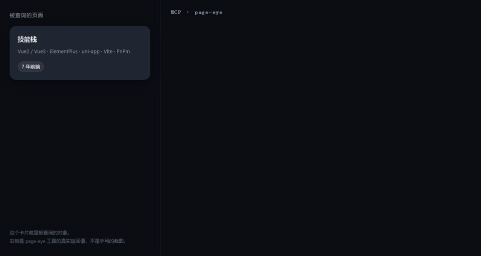

# page-eye

给 AI 编程助手一双看页面的眼睛。

AI 读的是源码，读不到浏览器**真正画出来的东西**——背景色可能是 `var(--x)` 叠了三层，间距可能来自组件库默认值，阴影可能是 `shadow-sm` 展开的五个值，图标可能是 `::before` 里一个看不见的私用区字符。而网络返回、console 报错、点击之后发生了什么——源码里根本没有。

仓库里有两个互补的工具，都围绕同一件事：**别让人转述，让 AI 直连现场。**



> 这不是手写截图。右侧每一行都是 `element_style` 工具的真实返回；最后一步改掉卡片的 `--card-bg` 再问一次，返回的新值就是浏览器此刻画出来的颜色。

## 最快路径（3 步）

**1. 起一个带调试端口的 Chrome**

```powershell
& "$env:LOCALAPPDATA\Google\Chrome\Application\chrome.exe" `
  --remote-debugging-port=9222 `
  --user-data-dir="$env:TEMP\cdp-profile"
```

> `--user-data-dir` 不是可选项。新版 Chrome 不允许在默认配置上开远程调试。
>
> macOS / Linux 把可执行文件换成 `google-chrome`（或 `/Applications/Google Chrome.app/Contents/MacOS/Google Chrome`），`--user-data-dir` 换成 `/tmp/cdp-profile`。

**2. 项目里建 `.trae/mcp.json`**

```json
{
  "mcpServers": {
    "page-eye": {
      "command": "node",
      "args": ["<克隆路径>/mcp-cdp/server.mjs"],
      "env": { "CDP_ENDPOINT": "http://127.0.0.1:9222" }
    }
  }
}
```

> - 路径必须**绝对**。
> - Trae 要先在 `设置 → MCP` 打开「项目级 MCP」开关。
> - 若 AI 报 `spawn node ENOENT`，把 `command` 换成 node 的绝对路径（`where node` / `which node`）。

**3. 对 AI 说一句**

> 用 page-eye 的 `element_style` 看一下 `.card` 的背景和阴影。

---

Cursor / Claude Code 用同一份 JSON，只是文件位置不同（`.cursor/mcp.json`、`claude mcp add`）。

**只是想让 AI 知道样式、不想装 MCP？** 直接看 [trae-style-snapshot](trae-style-snapshot/README.zh-CN.md) —— 控制台贴一段脚本，零配置。

## 仓库结构

```
mcp-cdp/              MCP server：通过 CDP 把页面的内容 / 行为 / 网络交给 AI
trae-style-snapshot/  浏览器脚本：把渲染后的样式压成一段 AI 能读的 JSON
```

## 19 个工具，按你熟悉的 DevTools 面板组织

这套接口基本对应你在 DevTools 里手动做的事。

### Elements —— 查看和改动 DOM

| 工具 | 作用 |
| --- | --- |
| `page_overview` | 标题、URL、DOM 规模、主要区块、请求分组、日志计数、最近错误 |
| `element_style` | 给选择器，返回渲染后的背景/阴影/边框/圆角/间距/字体，**以及每个值来自哪个 CSS 变量** |
| `a11y_tree` | 无障碍树：页面「是什么」（heading / link / button），比 DOM 树省 token 且带语义 |
| `frames` | 所有 frame 加 iframe / worker 子 target——用来判断内容是不是在别的 frame 里 |
| `screenshot` | 把 PNG（元素 / 视口 / 整页）存到磁盘并返回路径，绝不把 base64 灌进上下文 |
| `highlight` | 在页面上高亮元素，让「你指的那块」和 AI 指的是同一块 |

### Styles —— 查看和改动 CSS

| 工具 | 作用 |
| --- | --- |
| `element_style` | 计算值 + 变量溯源（见上） |
| `css_coverage` | 重载后统计 CSS 规则使用率：总数、用到、没用、按样式表分组——找死代码 |
| `emulate_media` | 强制 `prefers-color-scheme`、`print`、`prefers-reduced-motion`，一次抓多态 |

### Console —— 看消息、跑 JavaScript

| 工具 | 作用 |
| --- | --- |
| `console_logs` | console 输出、未捕获异常、浏览器日志；可按级别和关键字过滤 |
| `run_js` | 在页面里执行 JavaScript 并取值。逃生舱 |

### Sources —— 调试 JavaScript

| 工具 | 作用 |
| --- | --- |
| `debugger_ctl` | 暂停于异常、按 URL + 行号下断点、等待暂停并读调用栈、恢复、关闭 |

### Network —— 检查网络活动

| 工具 | 作用 |
| --- | --- |
| `network_list` | 请求摘要（不含正文）：method、URL、状态码、大小、耗时、失败原因 |
| `network_get` | 单条请求全貌：头、POST 体、响应体（超 8000 字落盘） |
| `net_conditions` | 禁缓存、模拟延迟与带宽、断网——用来诚实量化首屏 |
| `net_mock` | 拦截并伪造响应：mock 接口、改响应、模拟错误状态码 |

### Performance —— 优化速度

| 工具 | 作用 |
| --- | --- |
| `perf_metrics` | 布局/样式重算次数与耗时、脚本耗时、JS 堆、节点数 |

### 会话控制

| 工具 | 作用 |
| --- | --- |
| `targets` | 列出可调试标签，标出当前连的是哪个 |
| `use_target` | 按 index / id / URL 片段切换标签 |
| `recorder` | `status` 看缓冲、`clear` 清空、`reload` 从头录 |

## 为什么是这个形状

难点从来不是「能不能读到」，而是**什么该进上下文**。

一个真实页面 200+ 请求，一个列表接口 300KB JSON。全灌进对话，模型还没开始推理就先把上下文撑满了。所以整个 server 围绕三条规则：

1. **先索引，再下钻**：`network_list` 只回摘要加 `requestId`，看哪条由 AI 自己决定。
2. **大对象落盘**：响应体超过 8000 字写进 `.cdp-capture/`，只回预览和绝对路径。
3. **从已知起点开始录**：CDP 抓不到 attach 之前的请求，`recorder reload` 是让首屏采集完整的开关。

## 几个值得知道的设计决定

- **工具调用是串行的**：采集缓冲、连接、target 都是共享状态，并发改动不安全；交互式调试也不需要并行。一次发很多调用没问题，它们会排队。
- **`ensure()` 用单飞 Promise**：N 个并发调用只建一条 CDP WebSocket。少了这层，每个调用各建一条，被丢弃的连接仍会往共享缓冲写事件，同一行 console 被记 N 遍。
- **`recorder reload` 会阻塞其它调用**，直到页面稳定。这是有意的。

## 任意 MCP 客户端都能用

纯 stdio MCP server，除 Node 20+ 外没有运行时依赖。TRAE、Cursor、Claude Code 都可以直接驱动。

```powershell
node mcp-cdp/server.mjs          # 在 stdio 上说 JSON-RPC
```

## 验证

不是「应该能跑」，是量过的：

| 套件 | 结果 |
| --- | --- |
| `test-client.mjs`：传输、网络、console、多标签、`element_style` | **44 / 44**，多次连跑 |
| `capabilities-test.mjs`：十项扩展能力 | **22 / 22** |
| `concurrency-test.mjs`：5 路与 12 路并发 | **1 条 CDP 连接，事件数精确相符** |
| `trae-style-snapshot/verify-run.js` | **51 / 51** 断言 |
| `trae-style-snapshot` 边界输入 | **12 / 12** 不抛异常 |
| `trae-style-snapshot` 压力 | 4809 个 DOM 节点，`snapAll('*')` 12 ms |

## 环境要求

- Node.js 20+（用全局 `WebSocket` 和 `fetch`）
- Chrome 用 `--remote-debugging-port` 启动，且 `--user-data-dir` 不能是默认配置

## 许可

[MIT](LICENSE) © 2026 王虎 (Raywh)

---

[English](README.md)
