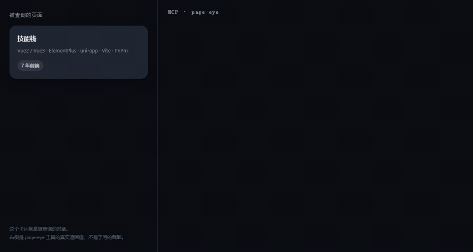

# mcp-cdp

让 AI 看到活页面的 MCP server：DOM、样式、console、网络、性能，全部走 Chrome DevTools Protocol。

零依赖（只用 Node 内置模块 + 全局 `WebSocket` / `fetch`）。一个进程同时是 MCP stdio server 和 CDP 客户端。



## 为什么是这个形状

CDP 是 DOM、网络体、console 唯一交汇的地方。但 AI 连不上调试端口——它只能调 MCP 工具。现成的 inspector MCP 只覆盖 DOM/CSS，没有网络、没有 console。

所以真正的设计问题是**什么该进上下文**，而不是怎么读。三条规则：

1. **先索引，再下钻**：`network_list` 只回摘要加 `request_id`，看哪条由 AI 决定。
2. **大对象落盘**：响应体超过 8000 字写进 `.cdp-capture/`，只回预览和绝对路径。
3. **从已知起点开始录**：CDP 抓不到 attach 之前的请求，`recorder reload` 是让首屏采集完整的开关。

## 配置

```powershell
# Chrome 必须用独立配置目录启动
& "$env:LOCALAPPDATA\Google\Chrome\Application\chrome.exe" `
  --remote-debugging-port=9222 `
  --user-data-dir="$env:TEMP\cdp-profile"
```

```json
{
  "mcpServers": {
    "page-eye": {
      "command": "node",
      "args": ["<绝对路径>/mcp-cdp/server.mjs"],
      "env": {
        "CDP_ENDPOINT": "http://127.0.0.1:9222",
        "CDP_CAPTURE_DIR": "<绝对路径>/mcp-cdp/.cdp-capture"
      }
    }
  }
}
```

| 环境变量 | 默认 | 作用 |
| --- | --- | --- |
| `CDP_ENDPOINT` | `http://127.0.0.1:9222` | Chrome 在哪 |
| `CDP_URL_CONTAINS` | — | 按 URL / 标题片段挑标签 |
| `CDP_CAPTURE_DIR` | `./.cdp-capture` | 落盘目录 |

## 工具

### 会话

#### `targets`
列出可调试标签并标出当前连的那个。AI 读错页面时先调它。

#### `use_target`
```json
{ "index": 0 }            // 或 { "id": "ABC..." } 或 { "urlContains": "localhost:3000" }
```
把会话钉到某个标签。切换会清空采集缓冲。

#### `recorder`
```json
{ "action": "reload", "ignoreCache": true, "waitMs": 3000 }
```
| action | 作用 |
| --- | --- |
| `status` | 当前缓冲大小与端点 |
| `clear` | 清空缓冲 |
| `reload` | 重载页面并从头录 |

> CDP 看不到 attach 之前的请求。要完整首屏，必须 `reload`。

#### `navigate`
```json
{ "url": "/add", "settleMs": 400 }
```
支持站内路径或完整 URL，等到 `readyState === 'complete'`，再留 `settleMs` 给应用渲染。返回最终 URL 与标题。Chrome 拒绝该 URL 时返回 `{ error }` 而不是抛异常。它会记住上一次可用的 origin，所以落在错误页之后仍能用相对路径恢复。

#### `interact`
```json
{ "action": "scroll", "to": "bottom", "steps": 30, "waitMs": 500 }
{ "action": "click", "text": "Vue" }
{ "action": "fill", "placeholder": "搜索题目关键词", "value": "闭包" }
{ "action": "press", "key": "Enter" }
```
定位方式三选一：CSS `selector`、可见 `text`（先精确匹配再前缀匹配）、`placeholder`。填表用的是原生 value setter 加 `input`/`change` 事件，所以 Vue / React 的绑定能吃进去。

每次调用都回报「变了什么」，这才是重点：

```json
{
  "ok": true,
  "action": "click",
  "clicked": "button",
  "label": "Vue",
  "changed": { "nodes": 0, "textLength": 125, "requests": 1, "logs": 0 }
}
```

`scroll` 在页面高度不再增长时提前停下，所以没有懒加载的页面不会白滚 30 步。

### Elements

#### `page_overview`
无参数。返回标题、URL、DOM 规模、主要区块、请求分组、日志计数和最近几条错误。适合第一个调。

#### `element_style`
```json
{
  "selector": "skill-block",                     // 裸名字也行：依次试 #x 和 .x
  "properties": ["background", "shadow"],        // 可选过滤
  "max": 6
}
```
返回最多 `max` 个**变体**（样式完全相同的会合并，带 `count`）：

```json
{
  "selector": ".skill-block",
  "matched": 3,
  "variants": 1,
  "nodes": [{
    "sel": "div.skill-block:nth-of-type(1)",
    "size": "421×166",
    "padding": "24px 26px",
    "bg": "rgb(255, 255, 255)",
    "radius": "20px",
    "border": "1px solid rgb(231, 227, 218)",
    "shadow": "rgba(27, 28, 32, 0.04) 0px 1px 2px 0px, rgba(27, 28, 32, 0.04) 0px 2px 8px 0px",
    "color": "rgb(27, 28, 32)",
    "font": "400 16px/28px -apple-system",
    "vars": { "bg": ["--card"], "shadow": ["--shadow-sm"], "radius": ["--radius-lg"] },
    "count": 3
  }]
}
```

`properties` 可取：`background` `shadow` `border` `radius` `spacing` `layout` `typography` `color` `effect` `vars`。`vars` 会跟着过滤——只问 `background` 就只回 `vars.bg`。

变量溯源的做法是把每个 `--*` 值丢进隐藏探针规范化，所以 `#2563eb`、`rgb(37,99,235)`、以及书写顺序不同的 `box-shadow` 都能对上。探针用完即删。

快照脚本**每个文档只注入一次**，挂在 `window.__pe` 下；它本来会覆盖的页面全局（`snap`、`page`、`pick` 等）会立刻还原。导航到新文档时会重新注入。

#### `a11y_tree`
```json
{ "roles": "heading,link,button", "limit": 40 }
```
无障碍树——博客首页 1300 多个 AX 节点，真正有语义的只有一两百个。比 DOM 树省 token 且直接带语义。

#### `frames`
无参数。所有 frame 加 iframe / worker 子 target。如果「找不到」某个内容，通常是在另一个 frame 里。

#### `screenshot`
```json
{ "selector": "main" }   // 或 { "fullPage": true }，都不传就是当前视口
```
PNG 写到 `CDP_CAPTURE_DIR`，返回 `{ path, bytes, clip }`。base64 不进上下文。

#### `highlight`
```json
{ "selector": ".card", "color": "#00b3ff" }
```
用 Overlay 域高亮元素。`{ "clear": true }` 清除。

### Styles

#### `css_coverage`
```json
{ "reload": true, "waitMs": 3000 }
```
禁缓存重载、记录规则使用情况，然后返回：
```json
{ "rules": 166, "used": 166, "unused": 0, "unusedPct": 0, "sheets": [...] }
```
Chrome 的判据是「这条规则匹配到了至少一个元素」——所以跨页面导航后（共用样式表）才最有意义。

#### `emulate_media`
```json
{ "scheme": "dark", "media": "print", "reducedMotion": "reduce" }
```
强制媒体特性，并回报页面此刻看到的值（`scheme`、`bodyBg`、`bodyColor`）。`{ "reset": true }` 恢复。

#### `resize`
```json
{ "width": 390, "height": 844, "mobile": true, "reload": true }
{ "reset": true }
```
改布局视口，并顺带做一次体检：

```json
{
  "viewport": "390x844",
  "windowWidth": 390,
  "scrollbarPx": 0,
  "horizontalOverflow": false,
  "overflowPx": 0,
  "offenders": [],
  "smallTapTargets": 1
}
```

两个需要注意的细节：

- `viewport` 取的是 `clientWidth`（不含滚动条），`windowWidth` 是 `innerWidth`。桌面上那 15px 差值是滚动条，不是 bug——`scrollbarPx` 会明确报出来。
- `mobile: true` 时，页面如果**没有** `<meta name="viewport" content="width=device-width">`，会按 980px 排版再缩放。出现这种情况时响应里会带一条 `note` 解释，而不是悄悄给你一个你没要的视口。

### Console

#### `console_logs`
```json
{ "level": "error,exception", "contains": "boom", "limit": 40 }
```
采集 `console.*`、未捕获异常、浏览器日志（CSP、资源失败）。

> CDP 里 `console.warn` 的 type 是 `warning`。本 server 统一成 `warn`，过滤时也接受 `warning`。

#### `run_js`
```json
{ "expression": "document.title", "awaitPromise": true, "maxLength": 6000 }
```
逃生舱。读 DOM、算样式、点按钮、调接口。

### Sources

#### `debugger_ctl`
```json
{ "action": "exceptions", "state": "uncaught" }
{ "action": "break", "urlRegex": "main\\.js", "lineNumber": 41 }
{ "action": "wait", "timeoutMs": 8000 }
{ "action": "resume" }
{ "action": "off" }
```
`wait` 会阻塞到调试器暂停，返回最多 8 层调用栈（`fn`、`url`、`line`），除非传 `"resume": false` 否则自动恢复。

### Network

#### `network_list`
```json
{ "url": "/api/", "method": "POST", "status": 500, "failedOnly": true, "limit": 30 }
```
只回摘要，每条带 `requestId`、`body` 标记（`inline` / `file:<路径>` / `pending`）和 `size`。

#### `network_get`
```json
{ "requestId": "1234.56", "waitBody": true, "maxBody": 4000 }
```
头、POST 体、响应体。响应体超 8000 字以 `bodyFile` + `bodyPreview` 返回。

> 响应体只在请求还活在渲染进程里时可得。本 server 在 `loadingFinished` 当场抓取；事后查询会得到 `No resource with given identifier`。

#### `net_conditions`
```json
{ "cacheDisabled": true, "latencyMs": 150, "downloadKbps": 400, "uploadKbps": 400 }
{ "reset": true }
```
设置会一直生效，直到 reset。配合 `recorder reload` 能量化真实首屏。

#### `net_mock`
```json
{ "urlPattern": "/api/items", "status": 500, "body": "{\"error\":\"boom\"}" }
{ "clear": true }
```
启用 Fetch 域并伪造匹配的请求，未匹配的原样放行。

### Performance

#### `perf_metrics`
无参数。布局/样式重算次数与耗时、脚本与任务耗时、JS 堆、节点数。

## 和其他浏览器 MCP 的区别

`chrome-devtools-mcp`（官方、63 个工具、Puppeteer 输入自动化、性能 trace、14 个堆快照工具）能力更全，需要浏览器自动化或性能分析时优先用它。

本 server 的定位：**零依赖、上下文纪律、CSS 变量溯源**。完整对比表在[根 README](../README.zh-CN.md)。

## 取消

长任务（`navigate`、`interact` 的 `scroll`）在每一步之间检查取消标记，所以客户端超时后队列能真的腾出来：

```json
{"jsonrpc":"2.0","method":"notifications/cancelled","params":{"requestId":7}}
```

该调用会返回一个提到「取消」的错误，串行队列继续往下走。**单条在途的 CDP 命令无法中断**，能打断的只是它外面的轮询循环。

## 已经处理掉的坑

| 坑 | 处理 |
| --- | --- |
| 响应体会失效 | 在 `loadingFinished` 当场抓 |
| `console.warn` 在 CDP 里叫 `warning` | 统一成 `warn` |
| `postData` 在 `requestWillBeSent` 里是可选的 | 兜底调 `Network.getRequestPostData` |
| `data:` URL 本身包含整个 body | 输出里截断，正文从 body 字段给 |
| 缓存命中时 `encodedDataLength` 仍非 0 | 单独报 `fromCache` 和 `pagePerf` |
| 并发调用各开一条 CDP socket | `ensure()` 单飞；工具调用串行化 |

## 性能

夹具页面实测（Chrome 157 headless）：

| 项目 | 结果 |
| --- | --- |
| 冷启动（spawn → 首次 ping） | 39 ms |
| 首次工具调用（含建 CDP 连接） | 36 ms |
| 工具延迟（热态） | p50 0–3 ms，p95 ≤ 8 ms（`highlight` 首次 18 ms） |
| 10 个并行 vs 10 个串行 `run_js` | 8 ms vs 15 ms |
| 相对裸 CDP `Runtime.evaluate` 的额外开销 | 约 1 ms（p50） |
| 额外 2000 个 DOM 节点 | `page_overview` 55 ms、`element_style` 14 ms、`a11y_tree` 138 ms |
| 400 次导航 | RSS 47 → 88 MB，呈阶梯式 GC 锯齿，无线性增长（缓冲上限 500 / 800 / 400） |

自己跑：`node perf-test.mjs`（需要 `serve.mjs` 和打了调试端口的 Chrome）。

## 边界

- 只覆盖主 frame —— 跨域 iframe 和 worker 需要 `Target.setAutoAttach`（`frames` 能列出来，但还读不到内容）
- 不抓 WebSocket 帧（`Network.webSocketFrameReceived` 没接）
- 请求与日志缓冲上限 500 / 800 条，超了丢最旧的
- 二进制响应体只做标记，不存内容
- `recorder reload` 会阻塞其它工具调用直到页面稳定
- `.cdp-capture/` 会持续增长，需要自己清理

## 验证

```powershell
node run-tests.mjs              # 全部套件，113 条
node run-tests.mjs service      # 只跑某个套件
```

跑器会起夹具服务，并且**每个套件都用一台全新的 Chrome**，套件之间不会互相泄漏状态（多出来的标签、mock、媒体模拟、缓冲）。

| 套件 | 条数 | 覆盖 |
| --- | --- | --- |
| `transport`（`test-client.mjs`） | 44 | 握手、200/404/500、POST 体、大 body 落盘、console 各级别、多标签切换、`element_style` |
| `capabilities`（`capabilities-test.mjs`） | 38 | 十项扩展工具的正常路径 + 副作用 |
| `service`（`suite-service.mjs`） | 46 | 协议错误、每个工具的错误路径、生命周期 |
| `concurrency`（`concurrency-test.mjs`） | 各 4 | 只建一条 CDP 连接，事件不重复 |

**全部套件合计 136 / 136。**

写 `suite-service.mjs` 时立刻抓出两个被旧套件掩盖的真 bug：

1. **`highlight` 只在 `css_coverage` 先跑过时才工作。** 从没调过 `DOM.enable`，于是报 `DOM should be enabled first`。旧套件恰好先调了 `css_coverage`，把它盖住了。
2. **`run_js` 把一切结果都字符串化。** `matchMedia(...).matches` 回来是 `"false"`，HTTP 状态回来是 `"418"`。现在保留原生 JSON 类型，只在值过大时降级成截断字符串。

---

[English](README.md)
